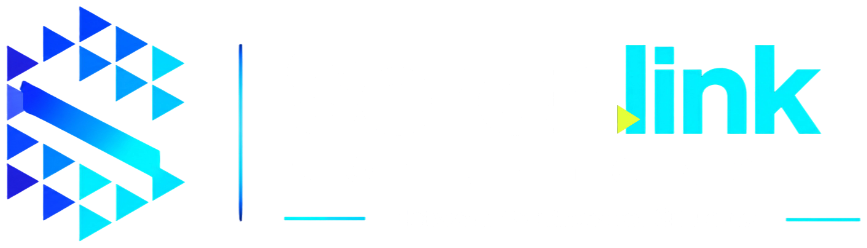
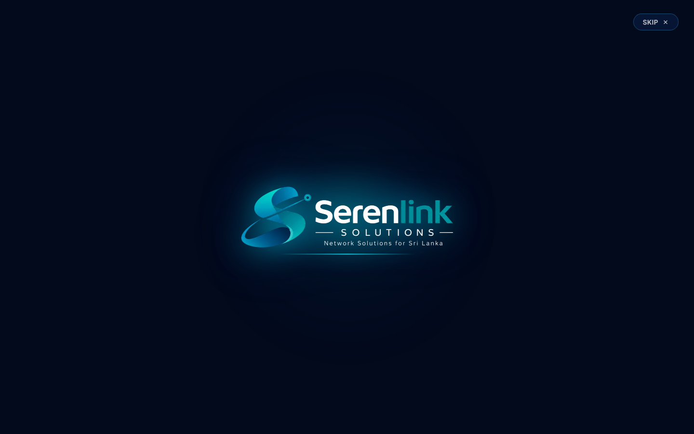
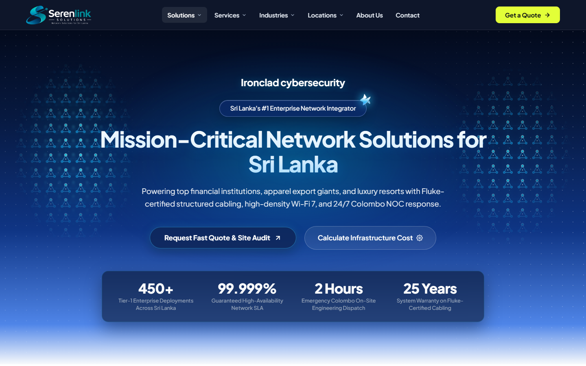
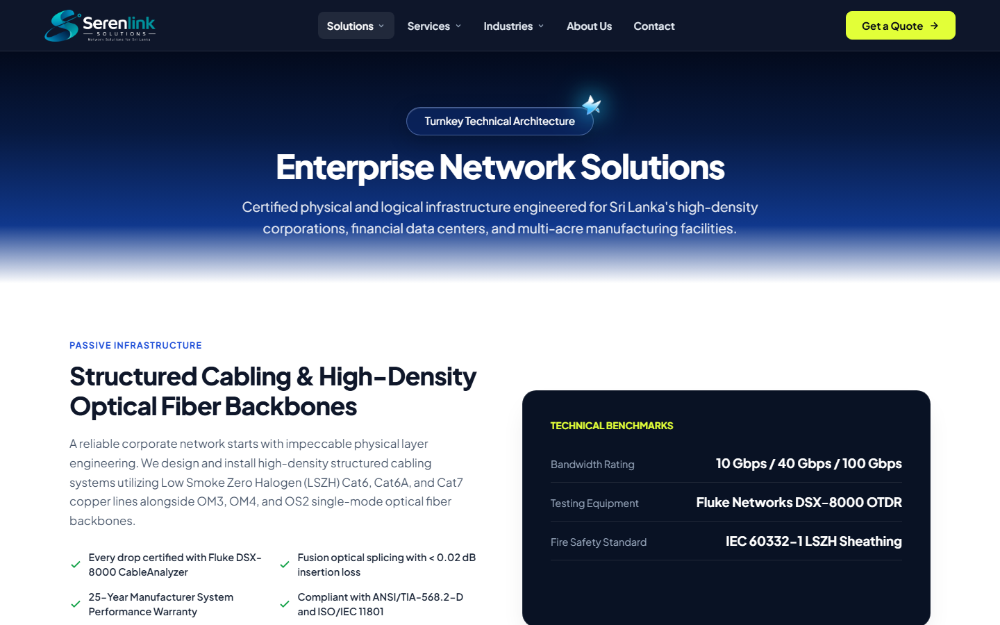
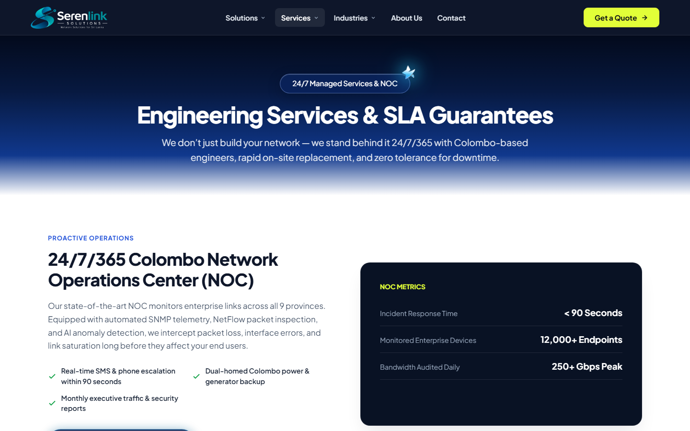
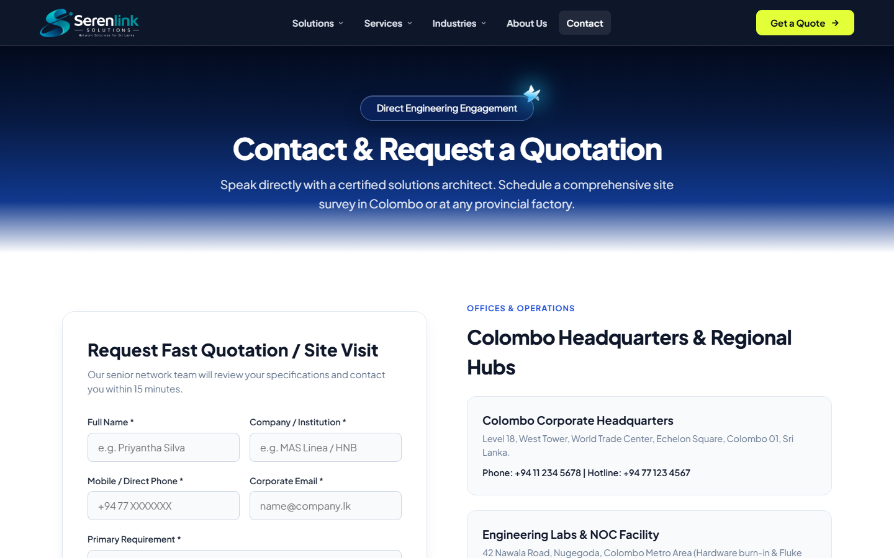

<div align="center">

  

  <br/>
  <h3>Enterprise Network Solutions for Sri Lanka 🌐🇱🇰</h3>
  <p>Fluke-Certified Structured Cabling, High-Density Wi-Fi 6E & Wi-Fi 7, Fortinet Zero-Trust Security, Data Centers & 24/7 Islandwide SLA Engineering.</p>

  <p>
    <a href="https://serenlink.runasp.net/"></a>
    <a href="https://d-navanith.github.io/serenlink-solutions/"></a>
    
    
    
    
  </p>

</div>

---

## 🆕 Latest Platform Updates (v2025.70)

* **Signature Dark Violet-Indigo & Neon-Lime Enterprise Theme**: Unified radial gradient surfaces (`#372772` → `#25286b` → `#0b1341` → `#01072b`) paired with high-contrast neon-lime (`#e2ff38`) and electric blue (`#2563eb`) accents across the sticky navbar, hero sections, benchmark cards, regional depot cards, interactive BOQ calculator, CTA capsule banners, and subpages.
* **Modern 2025 Enterprise Footer UI**: Redesigned `<footer class="main-footer">` featuring a live 24/7 Colombo NOC telemetry & quick-dispatch banner, pulsing neon-lime status indicator, interactive hotline & survey pills, glowing compliance badges, social/engineering connect buttons, animated chevron link columns, a glassmorphic Colombo Corporate HQ card, and a smooth Back-to-Top action bar.
* **Interactive "On What to Expect" 6-Card Grid + View More Toggle**: Displays the primary 6 specialized industry verticals (2 rows of 3 cards) by default with a right-aligned electric-blue **`View more`** toggle (`#industryViewMoreBtn`) that smoothly expands all 10 verticals on demand and works seamlessly alongside category filter pills.
* **3D Mechanical Odometer Trust Strip**: Hardware-accelerated vertical digit reels with staggered spring physics (`cubic-bezier(0.16, 1, 0.3, 1)`), directional motion blur, top/bottom cylinder vignette masks, and an ambient ghost-digit matrix backdrop on `.hero-trust-strip`.
* **Themed Enterprise Quotation & Architecture Popups**: Glassmorphic dark violet-indigo modal cards (`.quote-modal-card`, `.industry-modal-card`) featuring neon-lime focus rings, high-contrast inputs, and animated confirmation badges while keeping inline page forms crisp on light backgrounds.
* **Interactive Mega-Navigation & Hero Scroll Restoration**:
  * Top-level parent navigation items (**Solutions**, **Services**, **Industries**, **Locations**) are directly clickable links while also opening crisp white (`--bg-pure-white`) two-column mega-dropdowns on hover with an invisible mouse-bridge and 180ms grace timer.
  * Standard hero scroll restoration ensures refreshing or clicking **Home** / the brand logo always lands cleanly at the top of the Hero section (`scrollY = 0`).
* **Ultra-Fine Electric Line Pulses & Card Physics**: Delicate `0.75px–1.1px` SVG circuit traces with micro-node terminals and smooth 3D card hover elevation matching the *"On what to expect"* interaction model.
* **Google Search & SEO Optimization**: Multi-resolution favicons (`48px`–`256px`), `Googlebot-Favicon` rules in `robots.txt`, JSON-LD `Organization` & `WebSite` structured data, and dynamic SVG topology diagrams (`locations.html`).

---

## 🎬 Visual Tour & Website Previews

### 1. Cinematic Violet-Indigo Animated Splash Screen
> A smooth 5.4-second opening sequence featuring central seed particle blooms, violet-indigo and neon-lime network light trails, elliptical pulse rings, and converging data particles revealing the unified SerenLink brandmark.

<div align="center">
  
</div>

<br/>

### 2. Homepage Hero & 3D Odometer Trust Strip
> High-converting enterprise landing page featuring the dark violet-indigo hero canvas, interactive 3D mechanical odometer trust metrics (`450+`, `99.999%`, `2 Hours`, `25 Years`), turnkey infrastructure cards, and live network architecture visualizers.

<div align="center">
  
</div>

<br/>

### 3. Turnkey Enterprise Solutions & Interactive BOQ Estimator
> Engineered turnkey networking blueprints for Sri Lanka's core enterprise sectors, paired with an interactive Project Scope & BOQ Calculator that recommends cabling, switching, Wi-Fi 6/7 AP counts, and Fortinet firewall tiers in real time.

<div align="center">
  
</div>

<br/>

### 4. End-to-End Engineering Services & SLA Lifecycle
> Complete lifecycle network engineering: Ekahau Predictive RF Site Surveys, Fluke DSX-8000 OTDR Certification, Core Cutover & Migration, and 24/7 NOC Monitoring with guaranteed 2-hour Colombo & 4-hour islandwide emergency dispatch.

<div align="center">
  
</div>

<br/>

### 5. Fast Site Survey & Themed Quotation Modal
> Direct engineering consultation portal (`contact.html`) and instant popup quotation modal (`.quote-modal-card`) styled in our signature violet-indigo and neon-lime theme for rapid BOQ dispatch across all 9 provinces.

<div align="center">
  
</div>

<br/>

<div align="center">
  
</div>

---

## ✨ Technical Highlights & Architecture

* **Zero Bloat / 100% Vanilla Stack**: Built purely with semantic HTML5, modern CSS3 custom properties, and vanilla JavaScript without heavy bundle dependencies.
* **Hardware GPU Accelerated**: Smooth 60 FPS scroll reveals, Lenis-style inertial scrolling (`smooth-scroll.js`), 3D odometer reels, and SVG circuit path animations powered by CSS `transform` and `opacity`.
* **Smart Splash Screen Engine (`splash.js` & `splash.css`)**:
  * Plays in full on initial website entry and on every browser refresh/reload.
  * Hard 6.8s fail-safe timer guarantees page content is never blocked and respects `prefers-reduced-motion`.
* **Enterprise Mega-Menu Navigation**: Two-column responsive dropdown menus with hover grace timers, hit-target bridges, clickable top-level parent links, and mobile accordion drawers.
* **Cross-Platform Compatibility**: Fully responsive across mobile (`375px`), tablet (`768px`), and widescreen desktop (`1440px+`) viewports.

---

## 📂 Project Structure

```plaintext
network_solution/
├── assets/                  # High-resolution brand logos, favicons, and SVG badges
│   ├── serenlink_logo_white.png
│   ├── serenlink_symbol.png
│   └── partners/            # Certified partner logos (Cisco, Fortinet, Ruijie, Ubiquiti, etc.)
├── docs/
│   └── images/              # Documentation showcase screenshots
│       ├── splash_screen.png
│       ├── homepage_hero.png
│       ├── solutions_page.png
│       ├── services_page.png
│       ├── popup_modal.png
│       └── contact_page.png
├── index.html               # Main homepage, 3D odometer trust strip & architecture overview
├── solutions.html           # Turnkey enterprise solutions & interactive BOQ estimator
├── services.html            # Lifecycle engineering services & SLA response matrix
├── industries.html          # Sector blueprints (Banking/CBSL, Apparel FTZ, Hospitality, Ports)
├── locations.html           # Islandwide regional engineering hubs & interactive SVG map
├── about.html               # Company mission, certifications & engineering standards
├── contact.html             # On-site survey request & 24/7 emergency dispatch portal
├── style.css                # Enterprise design system, violet-indigo theme & responsive layout
├── script.js                # Navigation, 3D odometer reels, BOQ calculator & modal controllers
├── smooth-scroll.js         # Smooth inertial scrolling & hero scroll restoration
├── splash.css               # Isolated cinematic splash screen styles & keyframes
├── splash.js                # Splash timeline controller and accessibility fail-safes
├── robots.txt               # Search crawler & Googlebot-Favicon indexing directives
├── sitemap.xml              # Full XML sitemap for search engine discovery
├── web.config               # Production IIS / MonsterASP configuration (MIME types, headers)
└── README.md                # Project documentation
```

---

## 🚀 Getting Started

### Local Development
To run the website locally on port `8080`:

```bash
# Using Python's built-in HTTP server:
python -m http.server 8080

# Or execute the included batch script on Windows:
run_website.bat
```
Then open `http://localhost:8080` in your browser (append `?splash=1` to preview the cinematic splash intro at any time).

---

## 🌐 Deployment Options

### 1. MonsterASP.net / Windows IIS (`serenlink.runasp.net`)
1. The included `web.config` is pre-configured with default document routing (`index.html`), clean cache headers, and MIME maps for `.svg`, `.woff2`, `.webp`, and `.webmanifest`.
2. Upload the contents of `serenlink_deploy.zip` (or pull directly from `main`) to your `site/wwwroot` directory.

### 2. GitHub Pages
1. Push to the `main` branch of `https://github.com/d-navanith/serenlink-solutions.git`.
2. Navigate to **Settings** → **Pages** → **Deploy from a branch** (`main` / `/ (root)`).
3. Live mirror is published automatically at `https://d-navanith.github.io/serenlink-solutions/`.

---

## 📄 License & Credits
© 2026 **SerenLink Solutions (Pvt) Ltd**. All rights reserved.  
*Enterprise Network Infrastructure & Cybersecurity Engineering Across Sri Lanka.*
